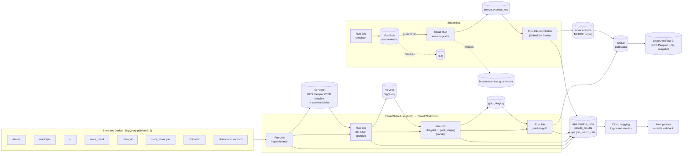

# Pipeline Híbrido para Análise da Alfabetização no Brasil

Tech Challenge – Fase 2 (POSTECH IAST). Pipeline **batch + streaming** em **arquitetura medalhão** no
**Google Cloud**, integrando as 6 entidades do dataset `br_inep_avaliacao_alfabetizacao` da Base dos Dados,
com portões de qualidade bloqueantes, observabilidade persistida, alertas e custo medido.

> ### Estado atual (leia primeiro)
> | Item | Estado |
> |---|---|
> | Código do pipeline, modelos dbt, Terraform, workflow | **Implementado** |
> | Testes automatizados (`pytest`, 40 testes) | **Passando localmente** |
> | `dbt parse` (Jinja, refs, testes e unit tests) e `terraform validate` | **Passando localmente** |
> | Provisionamento no GCP e execução na nuvem | **Pendente**: as seções marcadas com ⏳ serão preenchidas com job IDs, prints e contagens depois da primeira execução |
> | CI (`.github/workflows/ci.yml`) | Configurado; roda quando o repositório estiver no GitHub |
> | Vídeo executivo | Fora do escopo neste momento |
>
> Este README descreve no presente apenas o que existe no repositório. O que depende de execução na
> nuvem está marcado como ⏳.

---

## 1. Contexto do problema

O **Compromisso Nacional Criança Alfabetizada** quer que toda criança esteja alfabetizada ao fim do
2º ano do ensino fundamental. A Pesquisa Alfabetiza Brasil (Inep, 2023) fixou o ponto de corte de
**743 pontos** na escala Saeb. O **Indicador Criança Alfabetizada** é o percentual de estudantes
**avaliados** que atinge esse patamar, ponderado pelo peso amostral.

**Duas leituras de 2030, mantidas separadas** ([ADR-007](docs/decisoes/ADR-007-meta-pactuada-vs-universalizacao.md)):

| Leitura | Valor | Onde aparece |
|---|---|---|
| **Meta pactuada** (fonte oficial; trajetória anual 2024–2030) | `meta_alfabetizacao_2030 = 80` na rede pública | `gold.meta_vs_resultado` (`tipo_meta = 'PACTUADA'`) |
| **Universalização** (aspiração política) | 100% | **somente** em `gold.cenario_universalizacao` (`leitura = 'ASPIRACIONAL'`) |

## 2. Arquitetura



Detalhes e justificativas: [docs/ARQUITETURA.md](docs/ARQUITETURA.md) e [docs/decisoes/](docs/decisoes/).

### Camadas

| Camada | Onde | O que contém |
|---|---|---|
| **Bronze** | `gs://<bucket>/bronze/<entidade>/ingestion_date=<d>/run_id=<id>/*.parquet` + external tables `bronze.*`; `bronze.eventos_raw`, `bronze.eventos_quarentena` | Cópia fiel da fonte (colunas explícitas + `_ingested_at`, `_source_last_modified`). **Nunca sobrescrita** |
| **Silver** | dataset `silver` | `dicionario`, `diretorio_municipio`, `rede_map`, `indicador_municipio`, `indicador_uf`, `meta_linha_base`, `meta_trajetoria`, `alunos`, `eventos` + seeds (`uf_ibge`, `rede_sinonimos`, `rede_recortes`, `join_thresholds`) |
| **Gold** | `gold_staging` → (testes) → `gold` | `fct_alfabetizacao_municipio`, `fct_alfabetizacao_uf`, `fct_alfabetizacao_brasil`, `meta_vs_resultado`, `evolucao_temporal`, `cenario_universalizacao`, `validacao_cruzada_microdado`, `agg_microdado_recorte`, `ml_features_municipio`, views `vw_indicador_consolidado`, `vw_eventos_tempo_real` |
| **Ops** | dataset `ops` | `pipeline_runs`, `dq_results`, `join_match_rate`, `source_watermarks`, `stream_watermark`, views `vw_saude_pipeline`, `vw_latencia_streaming`, `vw_custo_por_execucao`, `vw_resumo_qualidade` |

### Uso das 6 entidades

| Entidade | Silver | Uso analítico na Gold |
|---|---|---|
| alunos | `alunos` | `agg_microdado_recorte` → peso de agregação, validação cruzada, `% abaixo de 743` |
| municipio | `indicador_municipio` | `fct_alfabetizacao_municipio`, `meta_vs_resultado` (MUN), `evolucao_temporal`, `ml_features_municipio` |
| uf | `indicador_uf` | `fct_alfabetizacao_uf`, `meta_vs_resultado` (UF), validação cruzada |
| meta_alfabetizacao_brasil | `meta_linha_base`, `meta_trajetoria` | taxa nacional oficial em `fct_alfabetizacao_brasil`; `meta_vs_resultado` (BR) |
| meta_alfabetizacao_uf | `meta_linha_base`, `meta_trajetoria` | `meta_vs_resultado` (UF); teste de consistência com `uf` |
| meta_alfabetizacao_municipio | `meta_linha_base`, `meta_trajetoria` | `meta_vs_resultado` (MUN); `feat_meta_pactuada_t_mais_1` |
| dicionario | `dicionario`, `rede_map` | decodificação de rede, série, presença, preenchimento e alfabetizado |

## 3. Tecnologias

| Ferramenta | Papel | Por quê | Estado |
|---|---|---|---|
| BigQuery | fonte, Silver, Gold, ops | A fonte já está lá (sem egress); on-demand com dry run para medir | Implementado |
| Cloud Storage | Bronze (Parquet ZSTD) e snapshot da Fase 3 | Histórico imutável e barato (retention policy + lifecycle) | Implementado |
| dbt Core 1.9 (`dbt-bigquery`) | transformações e testes | `error`/`warn` = bloqueante/informativa; linhagem; unit tests | Implementado |
| Pub/Sub | mensageria | push autenticado, retry com backoff, DLQ | Implementado |
| Cloud Run (service + jobs) | ingestor e etapas do pipeline | escala a zero; uma imagem para tudo | Implementado |
| Cloud Workflows + Scheduler | orquestração | dependência, retry e agendamento a custo próximo de zero | Implementado |
| Cloud Logging/Monitoring | métricas e alertas | log-based metrics + alert policies em Terraform | Implementado |
| Terraform | IaC | ambiente recriável por um comando, com diff revisável | Implementado |
| Looker Studio | dashboard | conecta direto na Gold e no ops | **Evolução futura** (não automatizado) |
| Schema no tópico Pub/Sub | validação no produtor | ver ADR-004 | **Evolução futura** |

## 4. Decisões arquiteturais

| Trade-off | Escolha | Detalhe |
|---|---|---|
| **Forma de acesso à fonte** | BigQuery nativo, região US | [ADR-001](docs/decisoes/ADR-001-acesso-a-fonte.md) (custo, egress, atualização da fonte) |
| **Data lake × warehouse** | Lakehouse: Bronze no GCS (imutável, barato, portável); Silver/Gold no BigQuery (SQL, testes, consumo) | [ADR-002](docs/decisoes/ADR-002-bronze-imutavel-no-gcs.md) |
| **Batch × streaming** | Os dois, com garantias diferentes (tabela abaixo) | [ADR-004](docs/decisoes/ADR-004-streaming-micro-lote.md) |
| **Custo × performance** | Serverless com escala a zero em vez de Composer/Dataflow | [ADR-003](docs/decisoes/ADR-003-orquestracao-serverless.md) |
| **Nuvem** | Uma só (GCP): sem egress entre nuvens, um billing, um IAM | — |
| **Chaves heterogêneas** | Vocabulário canônico de rede, com DESCONHECIDO bloqueante | [ADR-006](docs/decisoes/ADR-006-vocabulario-de-rede.md) |
| **Publicação da Gold** | Write-Audit-Publish | [ADR-005](docs/decisoes/ADR-005-qualidade-com-dbt-e-wap.md) |

### Forma de acesso: as três perguntas do enunciado

- **Por que esse caminho:** a fonte está no BigQuery público, na multi-região US. Ler de lá com colunas
  explícitas não exige transferência, permite dry run e mantém tudo em uma nuvem.
- **Custo:** bytes escaneados no nosso projeto (on-demand, 1 TiB/mês grátis). Egress entre nuvens e entre
  regiões é **zero**, porque bucket e datasets estão em `US`. Os bytes reais saem do dry run e de
  `INFORMATION_SCHEMA.JOBS` (seção 7).
- **Quando a fonte é atualizada:** o job compara `modified` de cada tabela de origem com
  `ops.source_watermarks`. Fonte igual: a entidade é pulada, sem scan. Fonte nova: um novo snapshot
  imutável é criado, e a Silver passa a ler o `run_id` mais recente. Snapshots antigos continuam
  disponíveis.

### Batch × streaming

| | Batch | Streaming |
|---|---|---|
| Gatilho / frequência | Scheduler a cada 6 h (pula fonte inalterada) | Contínuo na chegada; micro-lote a cada 5 min |
| Latência | horas | segundos até a Bronze; ≤ ~5 min até Silver/Gold |
| Unidade | snapshot da tabela | evento |
| Garantia de entrega | exactly-once por execução (caminho único + `overwrite=false` + watermark) | **at-least-once** (Pub/Sub). Duplicatas chegam à Bronze e são eliminadas na Silver por `MERGE` em `event_id`: **efetivamente exactly-once** |
| Ordem | irrelevante | não garantida; last-write-wins por `produced_at` |
| Dado inválido | reprova teste bloqueante e **para** o pipeline | vai para **quarentena** com o motivo, sem parar o fluxo; taxa alertada |
| Origem | `origem_dado = 'OFICIAL'` | `origem_dado = 'SIMULADO'` em toda linha, até a Gold |

**Latência medida de fato:** `produced_at` é carimbado pelo **simulador** ao criar o evento, e
`ingested_at` pelo **ingestor** ao recebê-lo (processos e relógios diferentes). `silver_processed_at` é
carimbado pelo `MERGE`. A view `ops.vw_latencia_streaming` calcula p50/p95/p99. Para provar que a métrica
mede algo, `python -m alfab simulate --atraso 5` retém cada evento por 5 s antes de publicar, e o p95
precisa subir na mesma medida. ⏳ evidência em `evidencias/streaming/`.

## 5. Como executar

Pré-requisitos: Python 3.12, [gcloud CLI](https://cloud.google.com/sdk/docs/install),
[Terraform ≥ 1.6](https://developer.hashicorp.com/terraform/install), um projeto GCP com faturamento.
`make` é opcional: cada alvo abaixo mostra o comando equivalente.

```bash
# 0. clonar e configurar (IDs ficam SÓ no .env e no terraform.tfvars, que não são versionados)
git clone <repo> && cd Projeto-Challenge
cp .env.example .env                                    # preencha GCP_PROJECT_ID, BRONZE_BUCKET, ALERT_EMAIL
cp infra/terraform.tfvars.example infra/terraform.tfvars  # mesmos valores
gcloud auth login && gcloud auth application-default login

# 1. ambiente Python e testes locais (sem nuvem)
python -m venv .venv && source .venv/bin/activate        # Windows: .venv\Scripts\activate
pip install -e ".[dev]"
pytest -q

# 2. infraestrutura (fase 1: imagem placeholder)
terraform -chdir=infra init
terraform -chdir=infra apply

# 3. imagem + deploy (fase 2: jobs e serviço com a imagem real)
gcloud builds submit --region us-central1 --tag us-central1-docker.pkg.dev/<PROJETO>/alfab/pipeline:v1 .
terraform -chdir=infra apply -var image=us-central1-docker.pkg.dev/<PROJETO>/alfab/pipeline:v1

# 4. profiling da fonte (confirma premissas antes do dbt) -> evidencias/profiling/
python -m alfab profile

# 5. pipeline batch na nuvem (ou localmente: python -m alfab pipeline)
gcloud workflows run alfab-pipeline-batch --location us-central1 --data='{}'

# 6. streaming
gcloud run jobs execute alfab-simulator --region us-central1 --wait
gcloud run jobs execute alfab-microbatch --region us-central1 --wait   # o Scheduler também roda a cada 5 min

# 7. demonstração de falha (deve terminar FAILED e disparar o alerta)
gcloud workflows run alfab-pipeline-batch --location us-central1 --data='{"fault_injection":"duplicate_keys"}'

# 8. FinOps, base da Fase 3 e evidências
python -m alfab finops        # -> evidencias/finops/custos_medidos.md
gcloud run jobs execute alfab-export-ml --region us-central1 --wait
python -m alfab evidencias    # -> evidencias/execucao.md
```

Equivalentes no Makefile: `make setup test infra-init infra deploy profile run-batch stream microbatch
demo-falha finops export-ml evidencias`.

## 6. Qualidade de dados

Catálogo completo, limiares e justificativas: **[docs/qualidade_regras.md](docs/qualidade_regras.md)**.

- **Bloqueantes** (`severity: error`): duplicidade no grão, chaves nulas, domínio (0–100, proficiência > 0),
  categoria `DESCONHECIDO` = 0, códigos confirmados pelo dicionário, **taxa de correspondência de cada
  join**, consistência entre a tabela de meta e a de indicador (UF), validação cruzada (UF e Brasil) e
  ausência de vazamento de alvo.
- **Informativas** (`severity: warn`): proporção de nulos em medidas, cobertura de metas municipais,
  consistência no nível municipal, Brasil ≈ UFs ponderadas.
- **Interrupção real:** o job sai com código 3, o Workflow para e a Gold não é publicada (Write-Audit-Publish).
  Nenhum `except` engole erro: `tests/test_observability.py` e `tests/test_quality_gate.py` verificam isso.
- **Persistência:** `ops.dq_results` (cada teste, a cada execução, inclusive reprovações) e
  `ops.join_match_rate` (histórico das taxas de match).
- **Falha demonstrada:** `fault_injection=duplicate_keys` ou `unmapped_rede`. ⏳ evidência em
  `evidencias/qualidade/`.

## 7. Monitoramento e FinOps

### Monitoramento

| O que | Como | Onde |
|---|---|---|
| Duração, linhas de entrada/saída, bytes, status por etapa | `track_step` grava cada etapa (append) | `ops.pipeline_runs`, `ops.vw_saude_pipeline` |
| Falha de ingestão / de etapa | log-based metric `alfab/step_failed` + alerta | e-mail (+ webhook opcional) |
| Job que morre antes de logar (OOM, timeout, imagem) | `run.googleapis.com/job/completed_execution_count{result=failed}` + alerta | e-mail |
| Pipeline que **parou de rodar** | ausência de `workflow_succeeded` por 13 h | e-mail |
| Backlog do streaming | `oldest_unacked_message_age > 300 s` | e-mail |
| Mensagens na DLQ | `num_undelivered_messages > 0` | e-mail |
| Latência do streaming | p95 de ingestão > 60 s (log-based distribution) | e-mail; `ops.vw_latencia_streaming` |
| Qualidade do streaming | taxa de quarentena > 10% | e-mail |
| Custo | billing budget 50/90/100% (se `billing_account` for informado) | e-mail |

Todos os alertas são recursos Terraform em [infra/monitoring.tf](infra/monitoring.tf).

**Em produção, quem descobre que o pipeline quebrou, e em quanto tempo?**
- **Falha ativa** (erro técnico ou regra bloqueante): o e-mail chega ao grupo pela alert policy, com
  janela de alinhamento de 60 s. Estimativa: **poucos minutos** após o FAILED. ⏳ tempo medido na
  demonstração de falha.
- **Falha silenciosa** (Scheduler parado, job que nunca inicia): alerta de ausência em **até 13 h**
  (duas janelas de 6 h sem sucesso).
- **Streaming travado:** backlog acima de 5 min por 5 min, ou seja, **~10 min**.

### FinOps

- Parquet + ZSTD; Bronze particionada por data/execução, com lifecycle Nearline/Coldline.
- Silver/Gold particionadas e clusterizadas (`alunos` por `ano`; cluster por UF/município).
- Colunas explícitas na leitura da fonte; o **watermark evita reprocessar fonte inalterada**.
- `maximum_bytes_billed` em toda query (Python e dbt).
- Labels `app`, `run_id`, `camada` e `etapa` em todo job, para custo por execução em `ops.vw_custo_por_execucao`.
- Escala a zero (Cloud Run); copy jobs gratuitos na publicação da Gold.

**Tabela de custo medida** ⏳ gerada por `python -m alfab finops` a partir de dry run,
`INFORMATION_SCHEMA.JOBS`, `INFORMATION_SCHEMA.TABLE_STORAGE`, tamanho real dos objetos no GCS e duração
real das etapas: **[evidencias/finops/custos_medidos.md](evidencias/finops/)**. Se a conta usada for
trial/free tier, isso será informado, e a projeção usa a cadência de produção (batch 6/6 h, micro-lote
5 min).

## 8. Aplicação em IA

`gold.ml_features_municipio` é a base preparada para a **Fase 3** (predição da taxa municipal em t+1):

- **Grão:** município × rede × ano t. Somente `origem_dado = 'OFICIAL'`.
- **Features (informação até t):** taxa, variação, média de português, proporção por nível de
  desempenho, alunos avaliados (ponderado), proficiência média, distância para a média da UF e a meta
  pactuada de t+1 (conhecida antes do resultado).
- **Alvo:** `alvo_taxa_t_mais_1`. Coluna `particao` = treino/inferência.
- **Anti-vazamento:** nenhuma coluna derivada do alvo (gap, status, atingiu). O teste bloqueante
  `assert_ml_sem_vazamento` lê o schema real e reprova se aparecer alguma. O split deve ser temporal.
- **Guardada para a Fase 3:** `python -m alfab export-ml` cria um snapshot BigQuery
  (`gold.ml_features_municipio_fase3_<data>`) e Parquet em `gs://<bucket>/gold/ml/fase3/versao=<data>/`.

Outros usos da Gold: ranking de desigualdade intra-UF (dispersão entre municípios), priorização de
municípios com maior `gap_pp` em relação à meta pactuada e acompanhamento quase em tempo real via
`vw_indicador_consolidado`.

## 9. Limitações conhecidas

- **Execução na nuvem pendente** neste momento (ver "Estado atual").
- **Streaming é simulado.** Os eventos são gerados a partir de municípios e taxas reais, mas os valores
  são sintéticos e marcados como `SIMULADO` em todas as camadas. Nunca entram nos fatos oficiais nem na
  base de ML.
- **Série histórica curta** (2 ou 3 anos): a projeção para 2030 é rotulada como cenário, não previsão. A
  base de ML terá poucos exemplos de treino.
- **Limiares de qualidade** partem de premissas e devem ser recalibrados com o baseline do profiling.
- **Premissas sobre códigos** (presença/preenchimento/alfabetizado = `"1"`) são verificadas por teste
  bloqueante contra o dicionário, mas só serão confirmadas na primeira execução.
- **Dashboard** (Looker Studio) não está automatizado.
- **Retention policy do bucket não travada**, para permitir desmontar o ambiente acadêmico.
- Investigação de anomalias: roteiro em [docs/investigacao_anomalias.md](docs/investigacao_anomalias.md);
  achados ⏳.

## 10. Evidências

⏳ Depois da execução: `evidencias/execucao.md` (contagens por tabela, execuções, qualidade, taxas de
join, latência), `evidencias/profiling/*.csv`, prints em `evidencias/{batch,streaming,qualidade,monitoramento}/`
e `evidencias/finops/custos_medidos.md`.

## 11. Estrutura do repositório

```
├── src/alfab/                 # código Python (CLI única: python -m alfab <comando>)
│   ├── bronze/ingest_batch.py # fonte -> Bronze (watermark, dry run, EXPORT DATA imutável)
│   ├── streaming/             # schema.py, simulator.py, ingestor.py, microbatch.py
│   ├── quality/run_dbt.py     # portão de qualidade (códigos de saída)
│   ├── ops/                   # publish (WAP), export_ml, finops, profile, evidence
│   ├── observability.py       # log estruturado + ops.pipeline_runs
│   └── config.py              # fonte única de configuração
├── dbt/                       # Silver, Gold, qualidade (models/, tests/, macros/, seeds/)
├── sql/gold_views/            # views da Gold (oficial + simulado separados por origem_dado)
├── workflows/                 # Cloud Workflows (pipeline batch)
├── infra/                     # Terraform (todos os recursos, inclusive alertas)
├── analises/                  # profiling da fonte
├── tests/                     # pytest
├── docs/                      # ARQUITETURA.md, decisoes/ (ADRs), qualidade_regras.md, investigacao_anomalias.md
├── evidencias/                # resultados de execução (⏳)
├── config/settings.yaml       # o que ingerir (colunas explícitas por entidade)
├── .env.example               # identificadores (projeto, bucket, e-mail)
├── Dockerfile · Makefile · pyproject.toml (dependências com versão fixa)
```

## 12. Vídeo executivo

Fora do escopo neste momento.
