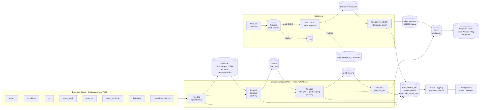
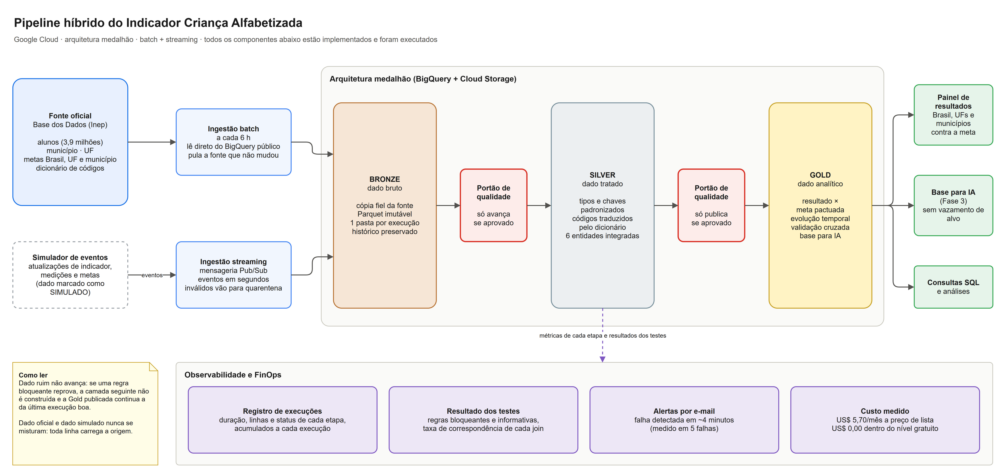
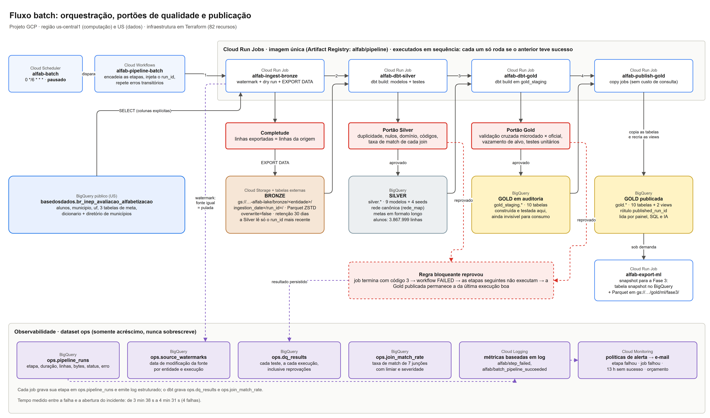
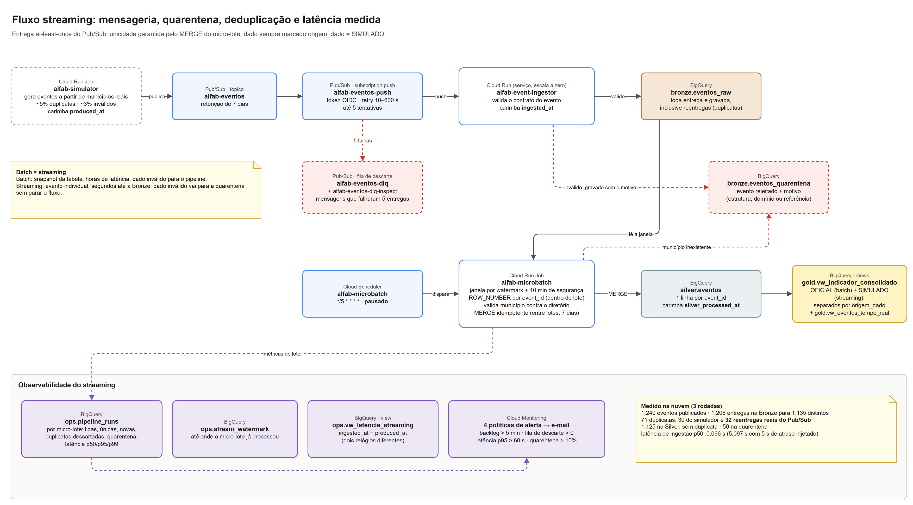

# Pipeline Híbrido para Análise da Alfabetização no Brasil

Tech Challenge – Fase 2 (POSTECH IAST). Pipeline **batch + streaming** em **arquitetura medalhão** no
**Google Cloud**, integrando as 6 entidades do dataset `br_inep_avaliacao_alfabetizacao` da Base dos Dados,
com portões de qualidade bloqueantes, observabilidade persistida, alertas e custo medido.

> ### Estado atual (leia primeiro)
> | Item | Estado |
> |---|---|
> | Infraestrutura no GCP (Terraform, 82 recursos) | **Provisionada** no projeto `midyear-cursor-510311-v9` ([evidência](evidencias/infra/terraform_state.txt)) |
> | Pipeline batch na nuvem (Workflows → Cloud Run Jobs) | **Executado**: em 01/10, 2 execuções publicaram a Gold e 4 foram barradas (documentadas). Em 02-03/11, com as ADR-008/009, a execução de aceite `20261103T002534Z-7e1e21` (imagem `pipeline:4531e38`, código da `main`) publicou a Gold e passou no `validar-adrs` |
> | Streaming na nuvem (Pub/Sub → Cloud Run → BigQuery) | **Executado**: 1.880 eventos publicados em 4 rodadas (01/10 e 02/11), 1.709 na Silver sem duplicatas |
> | Demonstração de falha + alerta | **Executada**: [evidência](evidencias/qualidade/demo_falha.md); alerta em ~4 min ([incidentes](evidencias/monitoramento/incidentes.md)) |
> | Custo medido | **Medido**: [tabela](evidencias/finops/custos_medidos.md) |
> | Testes automatizados (`pytest`, 58 testes), `dbt parse`, `terraform validate` | Passando localmente e no CI |
> | Agendadores (Cloud Scheduler) | Criados **pausados** de propósito (`schedulers_paused = true`); as execuções acima foram disparadas manualmente |
> | CI (`.github/workflows/ci.yml`) | Configurado; roda quando o repositório estiver no GitHub |
> | Dashboard | Gerado por `python -m alfab dashboard` a partir da Gold ([evidencias/dashboard/](evidencias/dashboard/)). Looker Studio não foi usado |
> | Vídeo executivo | Fora do escopo neste momento |
>
> **Ajustes de 28/10/2026, aceitos no GCP em 03/11/2026 (`validar-adrs`, run_id `20261103T002534Z-7e1e21`):**
> [ADR-008](docs/decisoes/ADR-008-avaliados-completos-bloqueantes.md) bloqueia avaliados sem
> classificacao/peso valido na Silver; [ADR-009](docs/decisoes/ADR-009-metas-historicas-sem-vazamento.md)
> remove da base de ML a meta de t+1 sem data historica comprovada de publicacao.
> Plano de testes e publicacao: [docs/validacao_ajustes_silver_gold.md](docs/validacao_ajustes_silver_gold.md).
> As evidências de estrutura, execução e dashboard foram regeneradas com `--aceite-run-id 20261103T002534Z-7e1e21`, e a
> base da Fase 3 foi exportada pelo comando com trava (`fase3_20261103_4531e38`). Ainda pendente do
> [roteiro](docs/ROTEIRO_EVIDENCIAS_ADR008_ADR009.md): o teste negativo do ADR-008 em **homologação** (seção 3).
> Os registros de console foram exportados por API para `evidencias/batch/` e `evidencias/streaming/`. Detalhes e a sequência de execuções de 02-03/11:
> [docs/validacao_ajustes_silver_gold.md](docs/validacao_ajustes_silver_gold.md), seção 6.

---

## 1. Contexto do problema

O **Compromisso Nacional Criança Alfabetizada** quer que toda criança esteja alfabetizada ao fim do
2º ano do ensino fundamental. A Pesquisa Alfabetiza Brasil (Inep, 2023) fixou o ponto de corte de
**743 pontos** na escala Saeb. O **Indicador Criança Alfabetizada** é o percentual de estudantes
**avaliados** que atinge esse patamar, ponderado pelo peso amostral.

**Duas leituras de 2030, mantidas separadas** ([ADR-007](docs/decisoes/ADR-007-meta-pactuada-vs-universalizacao.md)):

| Leitura | Valor | Onde aparece |
|---|---|---|
| **Meta pactuada** (fonte oficial; trajetória anual 2024–2030) | `meta_alfabetizacao_2030 = 80` na rede pública | `gold.meta_vs_resultado` (`tipo_meta = 'PACTUADA'`) |
| **Universalização** (aspiração política) | 100% | **somente** em `gold.cenario_universalizacao` (`leitura = 'ASPIRACIONAL'`) |

## 2. Arquitetura



Detalhes e justificativas: [docs/ARQUITETURA.md](docs/ARQUITETURA.md) e [docs/decisoes/](docs/decisoes/).

### Diagramas detalhados (draw.io)

O arquivo editável é [docs/arquitetura.drawio](docs/arquitetura.drawio) (3 páginas), gerado por
`python scripts/gerar_drawio.py`. As imagens abaixo são a exportação de cada página. Os diagramas mostram
somente o que está implementado e foi executado; os agendadores aparecem marcados como pausados.

**1. Visão geral**



**2. Fluxo batch: orquestração, portões de qualidade e publicação**



**3. Fluxo streaming: mensageria, quarentena, deduplicação e latência**



### Camadas

| Camada | Onde | O que contém |
|---|---|---|
| **Bronze** | `gs://<bucket>/bronze/<entidade>/ingestion_date=<d>/run_id=<id>/*.parquet` + external tables `bronze.*`; `bronze.eventos_raw`, `bronze.eventos_quarentena` | Cópia fiel da fonte (colunas explícitas + `_ingested_at`, `_source_last_modified`). **Nunca sobrescrita** |
| **Silver** | dataset `silver` | `dicionario`, `diretorio_municipio`, `rede_map`, `indicador_municipio`, `indicador_uf`, `meta_linha_base`, `meta_trajetoria`, `alunos`, `eventos` + seeds (`uf_ibge`, `rede_sinonimos`, `rede_recortes`, `join_thresholds`) |
| **Gold** | `gold_staging` → (testes) → `gold` | `fct_alfabetizacao_municipio`, `fct_alfabetizacao_uf`, `fct_alfabetizacao_brasil`, `meta_vs_resultado`, `evolucao_temporal`, `cenario_universalizacao`, `validacao_cruzada_microdado`, `agg_microdado_recorte`, `ml_features_municipio`, views `vw_indicador_consolidado`, `vw_eventos_tempo_real` |
| **Ops** | dataset `ops` | `pipeline_runs`, `dq_results`, `join_match_rate`, `source_watermarks`, `stream_watermark`, views `vw_saude_pipeline`, `vw_latencia_streaming`, `vw_custo_por_execucao`, `vw_resumo_qualidade` |

### Uso das 6 entidades

| Entidade | Silver | Uso analítico na Gold |
|---|---|---|
| alunos | `alunos` | `agg_microdado_recorte` → peso de agregação, validação cruzada, `% abaixo de 743` |
| municipio | `indicador_municipio` | `fct_alfabetizacao_municipio`, `meta_vs_resultado` (MUN), `evolucao_temporal`, `ml_features_municipio` |
| uf | `indicador_uf` | `fct_alfabetizacao_uf`, `meta_vs_resultado` (UF), validação cruzada |
| meta_alfabetizacao_brasil | `meta_linha_base`, `meta_trajetoria` | taxa nacional oficial em `fct_alfabetizacao_brasil`; `meta_vs_resultado` (BR) |
| meta_alfabetizacao_uf | `meta_linha_base`, `meta_trajetoria` | `meta_vs_resultado` (UF); teste de consistência com `uf` |
| meta_alfabetizacao_municipio | `meta_linha_base`, `meta_trajetoria` | `meta_vs_resultado` (MUN); **nao e usada como feature de ML** sem data comprovada (ADR-009) |
| dicionario | `dicionario`, `rede_map` | decodificação de rede, série, presença, preenchimento e alfabetizado |

## 3. Tecnologias

| Ferramenta | Papel | Por quê | Estado |
|---|---|---|---|
| BigQuery | fonte, Silver, Gold, ops | A fonte já está lá (sem egress); on-demand com dry run para medir | Implementado |
| Cloud Storage | Bronze (Parquet ZSTD) e snapshot da Fase 3 | Histórico imutável e barato (retention policy + lifecycle) | Implementado |
| dbt Core 1.9 (`dbt-bigquery`) | transformações e testes | `error`/`warn` = bloqueante/informativa; linhagem; unit tests | Implementado |
| Pub/Sub | mensageria | push autenticado, retry com backoff, DLQ | Implementado |
| Cloud Run (service + jobs) | ingestor e etapas do pipeline | escala a zero; uma imagem para tudo | Implementado |
| Cloud Workflows + Scheduler | orquestração | dependência, retry e agendamento a custo próximo de zero | Implementado |
| Cloud Logging/Monitoring | métricas e alertas | log-based metrics + alert policies em Terraform | Implementado |
| Terraform | IaC | ambiente recriável por um comando, com diff revisável | Implementado |
| Looker Studio | dashboard | conecta direto na Gold e no ops | **Evolução futura** (não automatizado) |
| Schema no tópico Pub/Sub | validação no produtor | ver ADR-004 | **Evolução futura** |

## 4. Decisões arquiteturais

| Trade-off | Escolha | Detalhe |
|---|---|---|
| **Forma de acesso à fonte** | BigQuery nativo, região US | [ADR-001](docs/decisoes/ADR-001-acesso-a-fonte.md) (custo, egress, atualização da fonte) |
| **Data lake × warehouse** | Lakehouse: Bronze no GCS (imutável, barato, portável); Silver/Gold no BigQuery (SQL, testes, consumo) | [ADR-002](docs/decisoes/ADR-002-bronze-imutavel-no-gcs.md) |
| **Batch × streaming** | Os dois, com garantias diferentes (tabela abaixo) | [ADR-004](docs/decisoes/ADR-004-streaming-micro-lote.md) |
| **Custo × performance** | Serverless com escala a zero em vez de Composer/Dataflow | [ADR-003](docs/decisoes/ADR-003-orquestracao-serverless.md) |
| **Nuvem** | Uma só (GCP): sem egress entre nuvens, um billing, um IAM | — |
| **Chaves heterogêneas** | Vocabulário canônico de rede, com DESCONHECIDO bloqueante | [ADR-006](docs/decisoes/ADR-006-vocabulario-de-rede.md) |
| **Publicação da Gold** | Write-Audit-Publish | [ADR-005](docs/decisoes/ADR-005-qualidade-com-dbt-e-wap.md) |
| **Aluno avaliado inconsistente** | Bloqueio da Silver (sem exclusao silenciosa); Gold antiga preservada | [ADR-008](docs/decisoes/ADR-008-avaliados-completos-bloqueantes.md) |
| **Meta historica como feature de ML** | Nao usar sem prova de disponibilidade em t; remover a feature t+1 | [ADR-009](docs/decisoes/ADR-009-metas-historicas-sem-vazamento.md) |

### Forma de acesso: as três perguntas do enunciado

- **Por que esse caminho:** a fonte está no BigQuery público, na multi-região US. Ler de lá com colunas
  explícitas não exige transferência, permite dry run e mantém tudo em uma nuvem.
- **Custo:** bytes escaneados no nosso projeto (on-demand, 1 TiB/mês grátis). Egress entre nuvens e entre
  regiões é **zero**, porque bucket e datasets estão em `US`. Os bytes reais saem do dry run e de
  `INFORMATION_SCHEMA.JOBS` (seção 7).
- **Quando a fonte é atualizada:** o job compara `modified` de cada tabela de origem com
  `ops.source_watermarks`. Fonte igual: a entidade é pulada, sem scan. Fonte nova: um novo snapshot
  imutável é criado, e a Silver passa a ler o `run_id` mais recente. Snapshots antigos continuam
  disponíveis.

### Batch × streaming

| | Batch | Streaming |
|---|---|---|
| Gatilho / frequência | Scheduler a cada 6 h (pula fonte inalterada) | Contínuo na chegada; micro-lote a cada 5 min |
| Latência | horas | segundos até a Bronze; ≤ ~5 min até Silver/Gold |
| Unidade | snapshot da tabela | evento |
| Garantia de entrega | exactly-once por execução (caminho único + `overwrite=false` + watermark) | **at-least-once** (Pub/Sub). Duplicatas chegam à Bronze e são eliminadas na Silver por `MERGE` em `event_id`: **efetivamente exactly-once** |
| Ordem | irrelevante | não garantida; last-write-wins por `produced_at` |
| Dado inválido | reprova teste bloqueante e **para** o pipeline | vai para **quarentena** com o motivo, sem parar o fluxo; taxa alertada |
| Origem | `origem_dado = 'OFICIAL'` | `origem_dado = 'SIMULADO'` em toda linha, até a Gold |

**Latência medida de fato:** `produced_at` é carimbado pelo **simulador** ao criar o evento, e
`ingested_at` pelo **ingestor** ao recebê-lo (processos e relógios diferentes). `silver_processed_at` é
carimbado pelo `MERGE`. A view `ops.vw_latencia_streaming` calcula p50/p95/p99. Para provar que a métrica
mede algo, o simulador aceita `--atraso 5`, que retém cada evento por 5 s antes de publicar.

**Medido na nuvem** (`ops.pipeline_runs`, etapa `microbatch.silver.eventos`):

| Data | Rodada | Eventos novos | Latência de ingestão p50 | p95 | Observação |
|---|---|---|---|---|---|
| 02/11 | Sem atraso | 548 | **0,057 s** | 18,3 s | o p95 é o cold start do ingestor (escala a zero) |
| 02/11 | Com `--atraso 5` | 36 | **5,072 s** | 5,7 s | a mediana sobe os 5 s injetados |
| 01/10 | Sem atraso | 542 | 0,066 s | 21,8 s | mesma medição, um mês antes |
| 01/10 | Com `--atraso 5` | 36 | 5,097 s | 7,65 s | |

**Duplicatas e inválidos, medidos:**
- **02/11:** 640 eventos publicados; 620 entregas na Bronze para 589 `event_id` distintos. As 31 duplicatas
  vieram do simulador (sem reentrega do Pub/Sub nesta rodada). 584 eventos novos na Silver, todos
  distintos; 25 na quarentena (20 por estrutura/domínio no ingestor, 5 por município inexistente no micro-lote).
- **01/10:** 1.240 eventos publicados; 1.206 entregas para 1.135 distintos. Das 71 duplicatas, o simulador
  gerou 39 e **as outras 32 foram reentregas reais do Pub/Sub** (at-least-once durante o cold start).
  1.125 na Silver e 50 na quarentena.
- **Total:** 1.709 eventos na Silver, todos distintos. **O evento chega à camada analítica:**
  `gold.vw_indicador_consolidado` tem 23.995 linhas `OFICIAL` e 294 `SIMULADO` (último valor por município),
  separadas por `origem_dado`.
A latência ponta a ponta até a Silver depende da cadência do micro-lote (5 min quando o agendador está
ativo); nas rodadas acima ele foi disparado manualmente.

## 5. Como executar

Pré-requisitos: Python 3.12, [gcloud CLI](https://cloud.google.com/sdk/docs/install),
[Terraform ≥ 1.6](https://developer.hashicorp.com/terraform/install), um projeto GCP com faturamento.
`make` é opcional: cada alvo abaixo mostra o comando equivalente.

```bash
# 0. clonar e configurar (IDs ficam SÓ no .env e no terraform.tfvars, que não são versionados)
git clone <repo> && cd Projeto-Challenge
cp .env.example .env                                    # preencha GCP_PROJECT_ID, BRONZE_BUCKET, ALERT_EMAIL
cp infra/terraform.tfvars.example infra/terraform.tfvars  # mesmos valores
gcloud auth login && gcloud auth application-default login

# 1. ambiente Python e testes locais (sem nuvem)
python -m venv .venv && source .venv/bin/activate        # Windows: .venv\Scripts\activate
pip install -e ".[dev]"
pytest -q

# 2. infraestrutura (fase 1: imagem placeholder)
#    bootstrap: APIs que o próprio Terraform precisa para ler o projeto e habilitar as demais
gcloud services enable cloudresourcemanager.googleapis.com serviceusage.googleapis.com --project <PROJETO>
terraform -chdir=infra init
terraform -chdir=infra apply

# 3. imagem + deploy (fase 2: jobs e serviço com a imagem real)
gcloud builds submit --region us-central1 --tag us-central1-docker.pkg.dev/<PROJETO>/alfab/pipeline:v1 .
terraform -chdir=infra apply -var image=us-central1-docker.pkg.dev/<PROJETO>/alfab/pipeline:v1

# 4. profiling da fonte (confirma premissas antes do dbt) -> evidencias/profiling/
python -m alfab profile

# 5. pipeline batch na nuvem (ou localmente: python -m alfab pipeline)
gcloud workflows run alfab-pipeline-batch --location us-central1 --data='{}'

# 6. streaming
gcloud run jobs execute alfab-simulator --region us-central1 --wait
gcloud run jobs execute alfab-microbatch --region us-central1 --wait   # o Scheduler também roda a cada 5 min

# 7. demonstração de falha (deve terminar FAILED e disparar o alerta)
gcloud workflows run alfab-pipeline-batch --location us-central1 --data='{"fault_injection":"duplicate_keys"}'

# 8. FinOps, base da Fase 3 e evidências
python -m alfab finops        # -> evidencias/finops/custos_medidos.md
gcloud run jobs execute alfab-export-ml --region us-central1 --wait
python -m alfab evidencias    # -> evidencias/execucao.md
```

Equivalentes no Makefile: `make setup test infra-init infra deploy profile run-batch stream microbatch
demo-falha finops export-ml evidencias`.

## 6. Qualidade de dados

Catálogo completo, limiares e justificativas: **[docs/qualidade_regras.md](docs/qualidade_regras.md)**.

- **Bloqueantes** (`severity: error`): duplicidade no grão, chaves nulas, domínio (0–100, proficiência > 0),
  categoria `DESCONHECIDO` = 0, códigos confirmados pelo dicionário, **taxa de correspondência de cada
  join**, consistência entre a tabela de meta e a de indicador (UF), validação cruzada (UF e Brasil) e
  ausência de vazamento de alvo.
- **Avaliados com classificacao ou peso invalido:** bloqueio (`assert_avaliados_completos`,
  `severity: error`, tag `silver`) para classificacao nula, peso nulo/nao positivo/nao finito.
  Ausentes nao sao imputados nem contam no denominador (ADR-008).
- **Informativas** (`severity: warn`): proporção de nulos em medidas, cobertura de metas municipais,
  consistência no nível municipal, Brasil ≈ UFs ponderadas.
- **Interrupção real:** o job sai com código 3, o Workflow para e a Gold não é publicada (Write-Audit-Publish).
  Nenhum `except` engole erro: `tests/test_observability.py` e `tests/test_quality_gate.py` verificam isso.
- **Persistência:** `ops.dq_results` (cada teste, a cada execução, inclusive reprovações) e
  `ops.join_match_rate` (histórico das taxas de match).
- **Falha demonstrada na nuvem** ([evidencias/qualidade/demo_falha.md](evidencias/qualidade/demo_falha.md)):
  com `fault_injection=duplicate_keys`, a regra `unique_combination_indicador_municipio_*` detectou 303
  chaves duplicadas, o job saiu com código 3, o workflow terminou FAILED, `dbt.gold` e `publish.gold`
  não executaram e as 10 tabelas da Gold publicada ficaram idênticas (`modified` e `published_run_id`).
- **Regra do ADR-008 reprovando na nuvem (02/11, execução `20261102T233638Z-1e9916`):** um teste negativo
  rodou no projeto principal minutos antes do merge do PR #4, com um modo de injeção que depois foi retirado
  (ele gravava avaliados inconsistentes na Silver). `assert_avaliados_completos` reprovou, o workflow
  terminou FAILED, a Gold ficou intacta e o alerta abriu em 4 min 3 s. O roteiro do PR #4 passou a exigir
  que esse teste rode em **homologação**, com dados sintéticos só dentro do teste; essa versão ainda não foi
  executada (ver limitações).
- **Falhas reais, não ensaiadas:** as 3 primeiras execuções foram barradas por regras/erros legítimos
  (recorte de rede inválido, validação cruzada, unit test). Cada uma está em `ops.dq_results` e virou
  um item da [investigação de anomalias](docs/investigacao_anomalias.md).
- **Validação cruzada (microdado × oficial):** 141 grupos UF, desvio mediano de **0,003 p.p.**; os 107
  grupos com ≥ 5.000 avaliados ficam dentro de 0,32 p.p. Sem peso amostral o desvio mediano seria
  0,516 p.p.; com ausentes no denominador, 6,542 p.p.

## 7. Monitoramento e FinOps

### Monitoramento

| O que | Como | Onde |
|---|---|---|
| Duração, linhas de entrada/saída, bytes, status por etapa | `track_step` grava cada etapa (append) | `ops.pipeline_runs`, `ops.vw_saude_pipeline` |
| Falha de ingestão / de etapa | log-based metric `alfab/step_failed` + alerta | e-mail (+ webhook opcional) |
| Job que morre antes de logar (OOM, timeout, imagem) | `run.googleapis.com/job/completed_execution_count{result=failed}` + alerta | e-mail |
| Pipeline que **parou de rodar** | ausência de `workflow_succeeded` por 13 h | e-mail |
| Backlog do streaming | `oldest_unacked_message_age > 300 s` | e-mail |
| Mensagens na DLQ | `num_undelivered_messages > 0` | e-mail |
| Latência do streaming | p95 de ingestão > 60 s (log-based distribution) | e-mail; `ops.vw_latencia_streaming` |
| Qualidade do streaming | taxa de quarentena > 10% | e-mail |
| Custo | billing budget 50/90/100% (se `billing_account` for informado) | e-mail |

Todos os alertas são recursos Terraform em [infra/monitoring.tf](infra/monitoring.tf).

**Em produção, quem descobre que o pipeline quebrou, e em quanto tempo?**
- **Falha ativa** (erro técnico ou regra bloqueante): o grupo recebe o e-mail da alert policy.
  **Tempo medido** entre a falha registrada e a abertura do incidente, em 5 falhas (4 em 01/10 e 1 em
  02/11): 3 min 38 s, 4 min 3 s, 4 min 14 s, 4 min 19 s e 4 min 31 s
  ([evidencias/monitoramento/incidentes.md](evidencias/monitoramento/incidentes.md)).
- **Falha silenciosa** (Scheduler parado, job que nunca inicia): alerta de ausência em **até 13 h**
  (duas janelas de 6 h sem sucesso).
- **Streaming travado:** backlog acima de 5 min por 5 min, ou seja, **~10 min**.

### FinOps

- Parquet + ZSTD; Bronze particionada por data/execução, com lifecycle Nearline/Coldline.
- Silver/Gold particionadas e clusterizadas (`alunos` por `ano`; cluster por UF/município).
- Colunas explícitas na leitura da fonte; o **watermark evita reprocessar fonte inalterada**.
- `maximum_bytes_billed` em toda query (Python e dbt).
- Labels `app`, `run_id`, `camada` e `etapa` em todo job, para custo por execução em `ops.vw_custo_por_execucao`.
- Escala a zero (Cloud Run); copy jobs gratuitos na publicação da Gold.

**Custo medido** ([evidencias/finops/custos_medidos.md](evidencias/finops/custos_medidos.md), gerado
por `python -m alfab finops --dias 35` em 03/11; a janela precisa incluir as rodadas de streaming e micro-lote). Cadência projetada: batch a cada 6 h (120/mês) e micro-lote a cada 5 min
(8.640/mês). A conta usada está dentro do nível gratuito, então a tabela traz as duas leituras.

| Serviço | Unidade | Quantidade medida | Como foi medida | Preço unitário | Lista (US$/mês) | Com nível gratuito |
|---|---|---:|---|---|---:|---:|
| BigQuery: ingestão da fonte | GiB faturado por ingestão completa | 0,32 | `INFORMATION_SCHEMA.JOBS`, camada=bronze (dry run: 0,25 GiB); 1 ingestão/mês | US$ 6,25/TiB | 0,00 | 0,00 |
| BigQuery: Silver + Gold + testes | GiB faturado por execução | 2,11 | `INFORMATION_SCHEMA.JOBS` por `run_id`, mediana das execuções publicadas | US$ 6,25/TiB (1 TiB grátis) | 1,55 | 0,00 |
| BigQuery: armazenamento | GiB-mês | 0,88 | `<dataset>.__TABLES__` | US$ 0,02/GiB (10 GiB grátis) | 0,02 | 0,00 |
| Cloud Storage (Bronze Parquet ZSTD) | GiB-mês | 0,058 | soma dos objetos do bucket | US$ 0,026/GiB | 0,00 | 0,00 |
| Pub/Sub + streaming insert | GiB/mês | 0,0004 | 1.826 entregas em `bronze.eventos_raw` (35 dias) | US$ 40/TiB + US$ 0,05/GiB | 0,00 | 0,00 |
| Cloud Run Jobs | vCPU-s/mês | 178.158 | `ops.pipeline_runs`: 135 s por batch, 18,7 s por micro-lote | US$ 0,000018/vCPU-s + US$ 0,000002/GiB-s | 3,92 | 0,00 |
| Workflows + Scheduler | passos/mês | 1.440 | 12 passos × 120 execuções; 2 jobs | US$ 0,01/1.000 passos; US$ 0,10/job | 0,21 | 0,00 |
| **Total** | | | | | **5,70** | **0,00** |

O que a medição mostrou:
- **O watermark funciona:** numa execução com a fonte inalterada, as 8 entidades da Bronze são puladas em
  ~0,2 s cada, sem byte faturado. A ingestão completa (3,9 milhões de alunos) fatura 0,32 GiB.
- **O maior custo de BigQuery é reconstruir Silver e Gold a cada 6 h** (2,11 GiB por execução), mesmo sem
  dado novo. Pular a transformação quando toda a Bronze foi pulada é a otimização seguinte (evolução futura).
- **Cloud Run usa 178,2 mil dos 180 mil vCPU-s gratuitos**, quase o limite. O micro-lote a cada 5 min é quem consome; é o
  primeiro item a virar custo se a cadência aumentar. A medição não inclui a inicialização do container.

## 8. Aplicação em IA

`gold.ml_features_municipio` é a base preparada para a **Fase 3** (predição da taxa municipal em t+1):

- **Grão:** município × rede × ano t. Somente `origem_dado = 'OFICIAL'`.
- **Features (informacao ate t):** taxa, variacao, media de portugues, proporcao por nivel de
  desempenho, alunos avaliados (ponderado), proficiencia media e distancia para a media da UF.
  **Meta de t+1 removida**: o `ano_referencia` da fonte nao prova quando a meta foi publicada;
  nao presumimos uma data historica. Ver ADR-009.
- **Alvo:** `alvo_taxa_t_mais_1`. Coluna `particao` = treino/inferência.
- **Anti-vazamento:** nenhuma coluna derivada do alvo (gap, status, atingiu), nem
  `feat_meta_pactuada_t_mais_1` sem data de publicacao comprovada. O teste bloqueante
  `assert_ml_sem_vazamento` le o schema real e reprova seu retorno. O split deve ser temporal.
- **Guardada para a Fase 3** (versão oficial): `python -m alfab export-ml --versao 2026-11-03-4531e38
  --aceite-run-id 20261103T002534Z-7e1e21` gerou o snapshot `gold.ml_features_municipio_fase3_20261103_4531e38` e o
  Parquet em `gs://midyear-cursor-510311-v9-alfab-lake/gold/ml/fase3/versao=2026-11-03-4531e38/` (23.995
  linhas, 26 colunas, sem `feat_meta_pactuada_t_mais_1`), ancorados na Gold aceita.
  - O snapshot de 2026-10-01 (esquema antigo, com a meta de t+1) foi **apagado** do BigQuery e do GCS em 02/11.
  - O snapshot `fase3_20261102`, gerado antes das travas do PR #4 e com o mesmo conteúdo, foi **apagado** do
    BigQuery em 03/11. O Parquet dele (`versao=2026-11-02/`) continua no GCS: a retention policy de 30 dias
    do bucket bloqueia a remoção até 02/12/2026.

Outros usos da Gold: ranking de desigualdade intra-UF (dispersão entre municípios), priorização de
municípios com maior `gap_pp` em relação à meta pactuada e acompanhamento quase em tempo real via
`vw_indicador_consolidado`.

## 9. Limitações conhecidas

- **Streaming é simulado.** Os eventos são gerados a partir de municípios e taxas reais, mas os valores
  são sintéticos e marcados como `SIMULADO` em todas as camadas. Nunca entram nos fatos oficiais nem na
  base de ML.
- **Série histórica curta** (2 ou 3 anos): a projeção para 2030 é rotulada como cenário, não previsão. A
  base de ML terá poucos exemplos de treino.
- **Proveniencia temporal das metas:** a fonte nao apresenta a data comprovada de publicacao por
  versao. A feature `feat_meta_pactuada_t_mais_1` foi retirada da base de ML (ADR-009),
  embora as metas continuem disponiveis para analises descritivas na Gold.
- **Teste negativo do ADR-008 em homologação ainda não executado.** O roteiro exige um projeto GCP de
  homologação separado (`ALFAB_HML_PROJECT_ID`), e o grupo tem só o projeto principal. A reprovação da regra
  foi observada uma vez no projeto principal, com outro mecanismo de injeção (ver seção 6).
- **Subscription da fila de descarte expirou** entre 01/10 e 02/11: o Pub/Sub apaga uma subscription após
  31 dias sem atividade, e o alerta da DLQ ficou sem efeito nesse intervalo. O Terraform a recriou e agora ela
  tem `expiration_policy { ttl = "" }` (`infra/pubsub.tf`).
- **Critério da validação cruzada calibrado após a 1ª execução** (porte ≥ 5.000 avaliados e cobertura
  completa de UFs), com a tolerância de 0,5 p.p. mantida. A decisão e os números estão na investigação (H2).
- **Lacunas da fonte que permanecem:** o microdado de 2023 não tem São Paulo; o DF não tem indicador
  estadual/público em 2024; 216 municípios não têm meta pactuada; os resultados de 2025 só existem nas
  tabelas de meta, sem casas decimais; 3 municípios divergem entre a tabela de meta e a de indicador.
- **Agendadores pausados:** as execuções foram manuais. O alerta de ausência (13 h) e a latência ponta a
  ponta de ~5 min do streaming não foram observados em regime contínuo.
- **Jobs demoram ~4 min para iniciar** (importação da imagem), o que alonga a execução batch para ~19 min,
  dos quais ~2,5 min são processamento.
- **`terraform apply` em duas fases** e bootstrap de 2 APIs via gcloud (documentados na seção 5).
- **Tags das imagens Docker:** as imagens no Artifact Registry foram marcadas com o identificador curto do
  commit local da época (`d3c7c5e` … `5340a01`). O histórico foi reaplicado sobre a `main` ao abrir o PR,
  então esses identificadores não correspondem mais a commits do repositório. Desde 03/11 a imagem em uso
  é `pipeline:4531e38`, gerada a partir da `main` (PR #4) com a correção da DLQ.
- **Dashboard** é uma página gerada pelo próprio pipeline; Looker Studio não foi configurado.
- **Retention policy do bucket não travada**, para permitir desmontar o ambiente acadêmico.
- Investigação de anomalias com 11 hipóteses e números medidos:
  [docs/investigacao_anomalias.md](docs/investigacao_anomalias.md).

## 10. Evidências

| Evidência | Arquivo |
|---|---|
| Recursos provisionados (82) e outputs do Terraform | [evidencias/infra/terraform_state.txt](evidencias/infra/terraform_state.txt) |
| Contagem de linhas por tabela, snapshots da Bronze, execuções, qualidade, joins, latência | [evidencias/execucao.md](evidencias/execucao.md) |
| Estrutura das camadas (tabelas, colunas, grão) | [evidencias/estrutura/](evidencias/estrutura/) (`analises/02_estrutura_camadas.sql`) |
| Profiling da fonte | [evidencias/profiling/](evidencias/profiling/) (`analises/01_profiling_fonte.sql`) |
| Demonstração de falha de duplicidade (01/10) | [evidencias/qualidade/demo_falha.md](evidencias/qualidade/demo_falha.md) |
| Aceite das ADRs 008/009 no GCP (03/11) e sequência de execuções | [docs/validacao_ajustes_silver_gold.md](docs/validacao_ajustes_silver_gold.md), seção 6 |
| Incidentes de alerta e tempo de detecção | [evidencias/monitoramento/incidentes.md](evidencias/monitoramento/incidentes.md) (`python scripts/incidentes_alerta.py`) |
| Custos medidos | [evidencias/finops/custos_medidos.md](evidencias/finops/custos_medidos.md) |
| Dashboard e os dados que o alimentam | [evidencias/dashboard/](evidencias/dashboard/) |
| Execuções batch exportadas das APIs (Workflows, Cloud Run Jobs, logs `step_finished`) | [evidencias/batch/](evidencias/batch/) (`python scripts/coletar_logs_gcp.py`) |
| Logs do streaming (simulador, micro-lote, eventos recebidos pelo ingestor via push) | [evidencias/streaming/logs_streaming.md](evidencias/streaming/logs_streaming.md) |

Identificadores para conferência no console: workflow `alfab-pipeline-batch`, execuções
`ca83f9f2-0a88-4ea3-ac9a-287f05cd47be` (publicada) e `b2078429-4134-4fbe-843b-cb64a9a49e07` (falha
demonstrada); builds do Cloud Build `14a4b3f7-6b19-4f4a-8b71-ed810b6bb6b9` e
`02c8a925-d10a-4ecf-ad11-dabd91c01d9c`; execução de aceite `7e1e21db-6776-4ec8-811a-e1619bdb4490`
(03/11, imagem `pipeline:4531e38`). Em vez de prints, os registros do console foram exportados pelas
APIs do GCP com IDs e horários UTC (`evidencias/batch/` e `evidencias/streaming/`). O Cloud Logging
guarda 30 dias, então os logs de 01/10 já expiraram; as execuções de 02-03/11 estão completas.

## 11. Estrutura do repositório

```
├── src/alfab/                 # código Python (CLI única: python -m alfab <comando>)
│   ├── bronze/ingest_batch.py # fonte -> Bronze (watermark, dry run, EXPORT DATA imutável)
│   ├── streaming/             # schema.py, simulator.py, ingestor.py, microbatch.py
│   ├── quality/run_dbt.py     # portão de qualidade (códigos de saída)
│   ├── ops/                   # publish (WAP), export_ml, finops, profile, evidence
│   ├── observability.py       # log estruturado + ops.pipeline_runs
│   └── config.py              # fonte única de configuração
├── dbt/                       # Silver, Gold, qualidade (models/, tests/, macros/, seeds/)
├── sql/gold_views/            # views da Gold (oficial + simulado separados por origem_dado)
├── workflows/                 # Cloud Workflows (pipeline batch)
├── infra/                     # Terraform (todos os recursos, inclusive alertas)
├── analises/                  # profiling da fonte
├── tests/                     # pytest
├── docs/                      # ARQUITETURA.md, decisoes/ (ADRs), qualidade_regras.md, investigacao_anomalias.md
│                              # arquitetura.drawio + img/ (diagramas exportados)
├── scripts/gerar_drawio.py    # gera o diagrama draw.io a partir de código
├── evidencias/                # resultados de execução na nuvem
├── dashboard/template.html    # template do painel (dados embutidos por python -m alfab dashboard)
├── config/settings.yaml       # o que ingerir (colunas explícitas por entidade)
├── .env.example               # identificadores (projeto, bucket, e-mail)
├── Dockerfile · Makefile · pyproject.toml (dependências com versão fixa)
```

## 12. Vídeo executivo

Fora do escopo neste momento.

## 13. Histórico de atualizações

| Data | O que mudou | Onde |
|---|---|---|
| 01/10/2026 | Primeira versão executada no GCP: infraestrutura (82 recursos), batch publicado, streaming, demonstração de falha, alertas, custos e snapshot da Fase 3 | PR #1 |
| 02/10/2026 | Diagramas da arquitetura em draw.io | PR #1 |
| 28/10/2026 | ADR-008 (avaliado inconsistente bloqueia a Silver) e ADR-009 (meta de t+1 sai da base de ML) | PR #2 |
| 02/11/2026 | Comandos com trava `validar-adrs`, `foto-gold`, `--aceite-run-id` e export versionado; roteiro de evidências | PR #4 |
| 02/11/2026 | Subscription da DLQ recriada e sem expiração; snapshot de 01/10 apagado; rodadas de streaming e teste negativo do ADR-008 no projeto principal | GCP |
| 03/11/2026 | Imagem da `main` implantada; execução de aceite `20261103T002534Z-7e1e21` aprovada no `validar-adrs`; Fase 3 exportada com trava; evidências regeneradas com `--aceite-run-id` | este PR |

