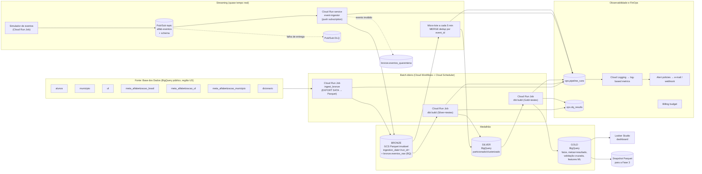
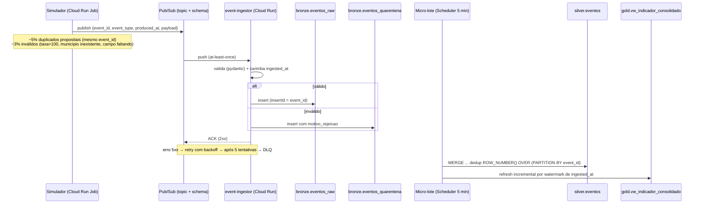

# Arquitetura: Pipeline Híbrido de Alfabetização no GCP

> Documento de desenho (Tech Challenge Fase 2 – POSTECH IAST).
> Estado: **desenho de referência; o código correspondente já está no repositório.** O que está
> implementado e o que depende de execução na nuvem estão no [README](../README.md). Onde a
> implementação ajustou este desenho, vale a seção 0 abaixo.

## 0. Ajustes feitos na implementação

| Tema | Desenho original | Implementado | Motivo |
|---|---|---|---|
| Schema da fonte | "confirmar no profiling" | Colunas conferidas nos modelos oficiais da Base dos Dados (`basedosdados/pipelines`, `models/br_inep_avaliacao_alfabetizacao`) e fixadas em `config/settings.yaml` | Evita adivinhar nomes de colunas |
| Grão do indicador | ano × local × rede × série | ano × local × rede (série é atributo); metas não têm série | É a chave única declarada pela própria fonte |
| Rede entre tabelas | normalizar para o código | `silver.rede_map` + vocabulário canônico (ADR-006) | O dicionário não cobre `rede` nas tabelas de meta |
| Publicação da Gold | Gold direto | Write-Audit-Publish: `gold_staging` → testes → `gold` (ADR-005) | "Antes de a camada seguinte ser publicada" |
| Cadência do batch e alerta de ausência | diária / 26 h | a cada 6 h / 13 h | O watermark torna a execução sem mudança quase gratuita, e a ausência é detectada mais rápido |
| Script de custo | `finops/medir_custos.py` | `src/alfab/ops/finops.py` (`python -m alfab finops`) | CLI única |
| Estrutura | §10 | Ver a seção 11 do README | — |

---

## 1. Leitura do enunciado: onde estão os pontos

| Critério | Pts | O que o avaliador vai procurar | Como este desenho responde |
|---|---|---|---|
| Ingestão híbrida | 15 | Mensageria, micro-lote, diferença batch×stream no README, tratamento de inválido/duplicado, evento chegando até a Gold | Pub/Sub + Cloud Run + DLQ + quarentena + `MERGE` com dedup por `event_id` + coluna `origem_dado` até a Gold (§4) |
| Medalhão | 15 | Bronze com histórico **de verdade**, Silver limpa e integrada, Gold analítica usando as 6 entidades | Bronze imutável em Parquet no GCS com retention lock; dbt para Silver/Gold (§3, §5) |
| Qualidade | 10 | Regras bloqueantes × informativas, pipeline **falhando** demonstrado, resultados persistidos, taxa de match dos joins | Testes dbt `error`/`warn` + teste genérico `join_match_rate` + `ops.dq_results` + `make demo-falha` (§6) |
| Monitoramento | 10 | Métricas persistidas e acumuladas, alerta real, latência medida de fato, "quem descobre e em quanto tempo" | `ops.pipeline_runs`, log-based metrics, alert policies por e-mail, alerta de ausência de execução (§7) |
| FinOps | 10 | Tabela com **números medidos** (dry run, bytes faturados, tamanho de objetos) | Labels de job por `run_id`, `INFORMATION_SCHEMA.JOBS`, script `finops/medir_custos.py`, budget (§8) |
| Cloud + repositório | 10 | Recursos realmente provisionados, evidências (job IDs, prints, contagens), config fora do código, sem credencial | Terraform + `.env`/`config.yaml` único + pasta `evidencias/` (§9, §10) |
| README | 5 | Seções obrigatórias, diagrama fiel ao implementado, limitações honestas | Esqueleto na §12 |
| Vídeo | 15 | — | **Fora do escopo neste momento** (será tratado depois) |
| **Diferenciais** | — | Validação cruzada microdado × oficial, orquestração, IaC, testes, anomalia investigada | Todos contemplados (§5.4, §9, §10, §11) |

---

## 2. Visão geral



**Princípios que guiam as escolhas**

1. **Nuvem única (GCP) e região US.** Os dados da Base dos Dados estão no BigQuery público, na multi-região `US`. Os datasets e o bucket do projeto também ficam em `US`. Assim não há egress, e o BigQuery aceita os joins, já que ele não junta datasets de regiões diferentes.
2. **Serverless com escala a zero.** Nada de cluster ligado. Cloud Composer (Airflow gerenciado) custa em torno de US$ 300–400/mês parado, e Dataflow tem custo mínimo por worker. Ambos são desproporcionais para o volume deste dataset. Trocamos por Workflows + Cloud Run, que custam centavos. Essa troca é uma decisão de FinOps documentada.
3. **Toda regra vira código versionado.** Qualidade (dbt tests), infraestrutura (Terraform), alertas (Terraform) e custo (script de medição).
4. **Oficial e simulado nunca se misturam sem rótulo.** Toda linha da Silver/Gold carrega `origem_dado ∈ {OFICIAL, SIMULADO}`.

---

## 3. Forma de acesso à fonte (vai para o README)

**Escolha:** consumir a fonte **nativamente no BigQuery** (`basedosdados.br_inep_avaliacao_alfabetizacao.*`) e materializar a Bronze com `EXPORT DATA` para Parquet no GCS.

| Pergunta do enunciado | Resposta |
|---|---|
| Por que esse caminho? | A fonte e o destino estão na mesma nuvem e região, então nada trafega pela internet. `SELECT` com colunas explícitas faz column pruning na origem. O download de arquivos exigiria um passo de upload e perderia o dry run como ferramenta de medição. |
| Custo | Paga-se **bytes escaneados** no projeto de faturamento do grupo (on-demand; o 1º TiB/mês é gratuito). `EXPORT DATA` não cobra além do scan. Egress entre nuvens: **zero**. Egress entre regiões: **zero** (tudo em US). O valor medido vem do dry run de cada query de ingestão (§8). |
| E quando a fonte for atualizada? | Antes de ingerir, o job lê `last_modified_time` de cada tabela da fonte (`basedosdados.br_inep_avaliacao_alfabetizacao.__TABLES__`) e compara com o último valor gravado em `ops.source_watermarks`. Se não mudou, a entidade é **pulada**, sem custo de scan. Se mudou, é gerado um novo snapshot Bronze em um novo `run_id`. Snapshots antigos são preservados, e a Silver sempre reconstrói a partir do snapshot mais recente de cada entidade. Assim a atualização da fonte é detectada, auditável e barata. |

**Trade-off assumido:** dependemos da disponibilidade do projeto público `basedosdados`. Se ele mudar o schema, o contrato de fonte do dbt (`sources.yml` com testes de colunas esperadas) falha de forma bloqueante antes da Silver.

---

## 4. Ingestão

### 4.1 Batch

- **Cloud Run Job `ingest_bronze`** (Python 3.12, `google-cloud-bigquery`):
  1. Gera um `run_id` (ULID) e registra `STARTED` em `ops.pipeline_runs`.
  2. Para cada uma das 7 tabelas: consulta o watermark, faz **dry run** (grava `bytes_estimados`) e executa
     `EXPORT DATA OPTIONS(uri='gs://<bucket>/bronze/<entidade>/ingestion_date=<d>/run_id=<id>/*.parquet', format='PARQUET', compression='ZSTD', overwrite=false) AS SELECT <colunas explícitas>, '<run_id>' AS _run_id, CURRENT_TIMESTAMP() AS _ingested_at FROM ...`
  3. Grava linhas exportadas, bytes faturados, duração e status em `ops.pipeline_runs`.
- `overwrite=false` faz o job **falhar** se o caminho já existir. É uma garantia física contra sobrescrita.
- A tabela `alunos` (microdado) é a maior. Medimos o tamanho com dry run e, se for relevante, a ingestão é filtrada por `ano` (partição da fonte), ano a ano.

### 4.2 Política de histórico da Bronze (exigida explicitamente na pág. 6)

| Mecanismo | Efeito |
|---|---|
| Caminho único por execução (`ingestion_date=/run_id=`) | Uma execução nunca escreve onde a anterior escreveu. |
| `EXPORT DATA ... overwrite=false` | Tentativa de sobrescrita gera erro, não perda silenciosa. |
| Bucket com **retention policy** (ex.: 365 dias) | Nem um operador consegue apagar objetos antes do prazo. |
| Lifecycle: Standard → Nearline após 30 dias, Coldline após 90 dias | Histórico barato (FinOps). |
| External tables BigLake (`bronze_ext.<entidade>`) com hive partitioning | A Silver lê só a partição `run_id` mais recente (partition pruning). |
| `bronze.eventos_raw` (BQ nativo) somente `INSERT`, particionada por `DATE(ingested_at)` | O mesmo princípio vale para o streaming. |

O README deve citar explicitamente que **não** usamos `WRITE_TRUNCATE`, `CREATE OR REPLACE` nem sobrescrita dinâmica de partição na Bronze. Na Silver/Gold, `CREATE OR REPLACE` é intencional, porque essas camadas são reconstruíveis a partir da Bronze.

### 4.3 Streaming



**Tipos de evento simulados:** `indicador_atualizado` (nova taxa para município/rede/série), `medicao_desempenho` (lote de proficiências) e `meta_revisada` (revisão de meta municipal). Todos carregam `origem_dado = 'SIMULADO'`.

**Garantias, explícitas no README:**

| | Batch | Streaming |
|---|---|---|
| Latência | Horas (execução diária) | Segundos até a Bronze; ≤ 5 min até a Silver/Gold |
| Frequência | 1×/dia (ou sob mudança da fonte) | Contínua na chegada; micro-lote a cada 5 min |
| Unidade | Snapshot completo da tabela | Evento individual |
| Entrega | Exactly-once por execução (caminho único + idempotência pelo watermark) | Pub/Sub entrega **at-least-once**, com duplicatas possíveis. Resultado **efetivamente exactly-once** via `MERGE` por `event_id` na Silver |
| Ordem | Irrelevante | Não garantida. Resolvida por *last-write-wins* em `produced_at` |
| Inválidos | Bloqueiam a execução (teste dbt `error`) | São isolados em quarentena, sem parar o fluxo. Contagem monitorada por alerta |

**Por que não Dataflow nem BigQuery continuous queries?** O primeiro tem custo mínimo por worker sempre ligado. O segundo exige reserva Enterprise. Para o volume simulado, micro-lote com `MERGE` demonstra o mesmo conceito com custo próximo de zero. Isso é um trade-off de FinOps registrado.

**Latência medida de fato:**
- `produced_at` é carimbado **pelo simulador** no momento de criar o evento.
- `ingested_at` é carimbado **pelo event-ingestor** ao receber o push, em outro processo e outro relógio.
- `silver_processed_at` é carimbado pelo `MERGE`.
- A view `ops.vw_latencia_streaming` calcula p50/p95/p99 de `ingested_at - produced_at` (ingestão) e de `silver_processed_at - produced_at` (ponta a ponta).
- Para provar que a métrica mede algo, o simulador tem o parâmetro `--atraso-artificial` que retém eventos por N segundos antes de publicar. O p95 precisa subir de forma correspondente, e essa é a evidência a registrar.

---

## 5. Medalhão

### 5.1 Uso das 6 entidades + dicionário

| Entidade | Onde entra | Produto analítico |
|---|---|---|
| `alunos` | `silver.alunos` | Validação cruzada (§5.4), distribuição de proficiência, % abaixo de 743 |
| `municipio` | `silver.indicador_municipio` | `gold.fct_alfabetizacao_municipio` |
| `uf` | `silver.indicador_uf` | `gold.fct_alfabetizacao_uf` |
| `meta_alfabetizacao_brasil` | `silver.meta` (nível `BR`) | `gold.meta_vs_resultado` (nível nacional) |
| `meta_alfabetizacao_uf` | `silver.meta` (nível `UF`) | `gold.meta_vs_resultado` (nível UF) |
| `meta_alfabetizacao_municipio` | `silver.meta` (nível `MUN`) | `gold.meta_vs_resultado` (nível município) |
| `dicionario` | macro `decode()` na Silver | Tradução de rede, série, presença etc., com categoria `DESCONHECIDO` e teste de contagem zero |

Opcional para os "dados territoriais" citados na pág. 3: `basedosdados.br_bd_diretorios_brasil.municipio` (nome, região, capital). Esse diretório também serve para validar `id_municipio`.

### 5.2 Silver: regras de tratamento

> Os nomes de colunas abaixo são ilustrativos. **Confirmar no profiling** (etapa 1 do plano) consultando `INFORMATION_SCHEMA.COLUMNS` da fonte e a tabela `dicionario`.

- **Tipos e nomes:** snake_case; `id_municipio` como `STRING` de 7 dígitos com `LPAD`; `ano` como `INT64`; taxas como `NUMERIC` em pontos percentuais.
- **Chaves na mesma língua:** comparar os valores distintos de `rede`/`serie` em cada tabela **antes** de juntar. É provável que uma tabela use código e outra use descrição. Tudo é normalizado para o código do dicionário.
- **Nulos:** nunca `COALESCE(x, 0)` em proficiência, taxa ou meta. O nulo é preservado e ganha um flag `tem_meta`, `tem_proficiencia`.
- **Dicionário:** `CASE` gerado a partir da tabela `dicionario`, com `ELSE 'DESCONHECIDO'` e teste bloqueante `count(DESCONHECIDO) = 0`.
- **Metas:** uma única tabela longa `silver.meta(nivel, id_local, rede, serie, ano_meta, meta_pct, tipo_meta='PACTUADA')`.
- **Eventos:** `silver.eventos` deduplicada, com `origem_dado='SIMULADO'`.
- **Metadados em toda tabela:** `_run_id`, `_bronze_run_id`, `_processed_at`, `origem_dado`.
- **Particionamento/cluster:** `PARTITION BY RANGE_BUCKET(ano, ...)` quando fizer sentido; `CLUSTER BY sigla_uf, id_municipio`.

### 5.3 Gold: modelos

| Modelo | Grão | Destaques |
|---|---|---|
| `fct_alfabetizacao_municipio` | ano × município × rede × série | Taxa oficial, alunos avaliados, região |
| `fct_alfabetizacao_uf` | ano × UF × rede × série | Idem |
| `fct_alfabetizacao_brasil` | ano × rede × série | **Ponderado por alunos avaliados**, nunca média simples. Se existir uma coluna de média simples, ela se chama `media_simples_municipios` |
| `meta_vs_resultado` | nível × local × ano × rede × série | Join **apenas no mesmo recorte** rede+série. `gap_pp = taxa - meta_pactuada`. `status_meta ∈ {ATINGIU, NAO_ATINGIU, SEM_META, SEM_RESULTADO}` (terceiro e quarto estados explícitos) |
| `evolucao_temporal` | local × ano | Variação ano a ano. Projeção até 2030 rotulada `cenario_tendencia_linear` (é um **cenário**, não uma previsão; há poucos pontos) |
| `cenario_universalizacao` | local | `distancia_universalizacao = 100 - taxa`, rotulado **ASPIRACIONAL**. Fica em tabela separada, nunca na mesma coluna da meta pactuada |
| `validacao_cruzada_microdado` | ano × UF (× município quando o n permitir) × rede × série | Ver §5.4 |
| `vw_indicador_consolidado` | — | `UNION ALL` entre o oficial e o simulado (streaming), com `origem_dado` |
| `ml_features_municipio` | município × ano *t* | Features até *t*, alvo em *t+1* (§11) |

**Meta 2030 (pág. 2–3):** toda a Gold usa a **meta pactuada da fonte** (`meta_alfabetizacao_2030 = 80` na rede pública). A leitura de universalização (100%) aparece **só** em `cenario_universalizacao`, com esse nome, e o README contém uma caixa de destaque explicando as duas leituras.

### 5.4 Validação cruzada (diferencial mais forte)

```sql
-- taxa recalculada a partir do microdado
SUM(IF(alfabetizado, peso, 0)) / SUM(IF(avaliado, peso, 0)) * 100
-- denominador = somente alunos avaliados (presentes e com caderno válido), com peso amostral
```

- Comparar com a taxa publicada (UF e Brasil) e calcular `diff_pp`.
- Teste: `|diff_pp| ≤ 0,5 p.p.` é **bloqueante** no nível UF. No nível município, fica **informativo**, porque amostras pequenas geram mais ruído. O limiar final deve ser justificado com a distribuição observada.
- Se divergir, isso vira a **investigação documentada** (outro diferencial). Hipóteses a testar: critério de presença, definição de "avaliado", filtro de rede, peso.

---

## 6. Qualidade de dados

**Ferramenta:** dbt Core (`dbt-bigquery`). O `severity: error` do dbt é a regra **bloqueante** e o `severity: warn` é a **informativa**, o que corresponde ao que o enunciado pede. `dbt build` executa model → testes → próximo model, e **pula tudo a jusante** quando um teste `error` falha. Assim a camada seguinte não é publicada.

| Regra | Onde | Tipo | Limiar |
|---|---|---|---|
| Schema da fonte bate com o contrato | sources | Bloqueante | 100% |
| PK única (duplicidade) | cada tabela Silver | Bloqueante | 0 duplicatas |
| Nulos em chaves | Silver | Bloqueante | 0 |
| Nulos em medidas (taxa, proficiência) | Silver | Informativa | % reportado |
| `DESCONHECIDO` após decode do dicionário | Silver | Bloqueante | 0 |
| Faixas válidas (taxa 0–100, proficiência > 0) | Silver | Bloqueante | 0 violações |
| **Taxa de match: indicador_municipio → diretório de municípios** | Silver | Bloqueante | ≥ 99% |
| **Taxa de match: indicador_municipio → meta municipal (mesmo rede/série/ano)** | Gold | Informativa + bloqueante mínima | Informativa abaixo do baseline medido; bloqueante se cair X p.p. abaixo do baseline (nem todo município pactuou meta, então 100% é irreal e a queda é o sinal) |
| **Taxa de match: indicador_uf → meta_uf** | Gold | Bloqueante | 100% das 27 UFs |
| **Taxa de match: alunos → indicador (UF)** | Gold | Bloqueante | ≥ 99% |
| Consistência Brasil ≈ Σ UFs ponderado | Gold | Bloqueante | ≤ 0,5 p.p. |
| Validação cruzada microdado × oficial | Gold | Bloqueante (UF) / Informativa (mun.) | §5.4 |
| Eventos em quarentena | streaming | Informativa + alerta | > 10% em 15 min |

- **Teste genérico `join_match_rate(left, right, keys, min_rate)`**: macro própria que retorna linhas quando `matched/total < min_rate`. Ela é aplicada **após cada junção**, como o enunciado exige.
- **Persistência:** hook `on-run-end` faz `INSERT` de cada resultado (`run_id`, `test_name`, `severity`, `status`, `failures`, `observed_value`, `threshold`, `executed_at`) em `ops.dq_results`, somente em modo append.
- **Sem `except` genérico que engole erro:** o entrypoint Python propaga o código de saída do dbt (`sys.exit(result.returncode)`). O Cloud Run Job termina `FAILED`, o Workflow termina `FAILED` e o alerta dispara. Um teste unitário garante esse comportamento.
- **Demonstrar falha (obrigatório):** `make demo-falha` roda o pipeline com `--vars '{fault_injection: duplicate_keys}'` (ou `unmapped_rede`), o que duplica chaves de propósito em uma tabela de staging. Evidências a guardar: output com `FAIL`, job `FAILED` no console, linha `FAIL` em `ops.dq_results`, e-mail do alerta e Gold **não** atualizada (timestamp inalterado).

---

## 7. Monitoramento e observabilidade

**Tabelas persistidas (append-only, dataset `ops`):**

| Tabela | Conteúdo |
|---|---|
| `ops.pipeline_runs` | `run_id, pipeline (batch/stream), etapa, started_at, ended_at, duracao_s, linhas_entrada, linhas_saida, bytes_faturados, status, erro` |
| `ops.dq_results` | §6 |
| `ops.source_watermarks` | `last_modified_time` da fonte por entidade e execução |
| `ops.vw_latencia_streaming` | p50/p95/p99 por janela de 5 min |
| `ops.vw_custo_por_execucao` | `INFORMATION_SCHEMA.JOBS` filtrado pelo label `run_id` |

**Alertas (todos em Terraform, portanto reais e revisáveis):**

| Alerta | Sinal | Canal |
|---|---|---|
| Falha em etapa do pipeline | Log-based metric `pipeline_step_failed` (log estruturado `severity=ERROR`) e execução de Workflow `FAILED` | E-mail do grupo + webhook (Google Chat/Discord) |
| **Pipeline não rodou** | Ausência de `pipeline_step_succeeded` por 26 h (metric absence) | E-mail |
| Backlog do streaming | `pubsub subscription oldest_unacked_message_age > 300s` | E-mail |
| Dead-letter | `num_undelivered_messages` na DLQ > 0 | E-mail |
| Latência de streaming | p95 > limiar (métrica customizada escrita pelo micro-lote) | E-mail |
| Orçamento | Billing budget em 50/90/100% | E-mail |

**Resposta à pergunta do README, "quem descobre e em quanto tempo":**
- Falha ativa (erro, teste bloqueante): o e-mail chega ao grupo em **≈ 1–5 min** (janela de avaliação da alert policy). Na evidência, medir o tempo real entre o `FAILED` e o e-mail.
- Falha silenciosa (Scheduler parou, job nunca iniciou): detectada pelo alerta de ausência em **≤ 26 h**.
- Streaming travado: backlog detectado em **≈ 5–10 min**.

**Dashboard (Looker Studio, gratuito):** página "Operação" (execuções, duração, linhas, custo, DQ) e página "Educação" (Gold). Convenções visuais: eixos sempre rotulados com unidade (%, p.p.); meta pactuada em linha tracejada; oficial em cor sólida e simulado em cor hachurada/clara com legenda "SIMULADO"; nenhum número citado no README que não esteja no dashboard.

---

## 8. FinOps

**Práticas aplicadas:**
- Bronze em Parquet com ZSTD, particionada por data/run, com lifecycle para Nearline/Coldline.
- Silver/Gold particionadas e clusterizadas; `require_partition_filter` nas tabelas grandes.
- `SELECT` com colunas explícitas, sem `SELECT *` na leitura da fonte. Um lint no CI barra `SELECT *` em `models/`.
- Watermark que evita reprocessar fonte inalterada, a maior economia de todas.
- `maximum_bytes_billed` em todo job (limite de segurança).
- Labels `run_id`, `camada` e `entidade` em todo job, para atribuir custo por execução.
- Cloud Run com `max-instances` baixo, CPU e memória dimensionadas pela medição.
- Budget com alertas.

**Tabela de custo (preencher com medição, não com premissa):**

| Serviço | Unidade | Quantidade medida | Como foi medida | Preço unitário* | Custo mensal projetado |
|---|---|---|---|---|---|
| BigQuery (scan da fonte) | TiB escaneado | _a medir_ | dry run + `total_bytes_billed` | US$ 6,25/TiB (on-demand, após 1 TiB grátis) | qtd × execuções/mês × preço |
| BigQuery (dbt Silver+Gold) | TiB escaneado | _a medir_ | `INFORMATION_SCHEMA.JOBS` por `run_id` | idem | |
| BigQuery storage | GiB-mês (lógico ativo) | _a medir_ | `INFORMATION_SCHEMA.TABLE_STORAGE` | ~US$ 0,02/GiB | |
| BigQuery streaming/Storage Write | GiB | _a medir_ | bytes inseridos | ~US$ 0,025/GiB (2 TiB/mês grátis) | |
| GCS Bronze | GiB-mês | _a medir_ | `gcloud storage du -s` | ~US$ 0,026/GiB (US multi-região) | |
| Pub/Sub | TiB de throughput | _a medir_ | métrica `byte_cost` | US$ 40/TiB (10 GiB grátis) | |
| Cloud Run (jobs + service) | vCPU-s, GiB-s | _a medir_ | duração do job × recursos | free tier depois tabela | |
| Workflows / Scheduler | passos / jobs | contagem | console | free tier (5 mil passos; 3 jobs) | |
| **Total** | | | | | |

\* Conferir e citar os preços da página oficial na data da medição. Se a conta for trial/free tier, dizer isso e projetar o custo de produção com a cadência pretendida (ex.: batch diário e streaming de N eventos/min, 24×7).

**Script `finops/medir_custos.py`:** faz dry run de todas as queries, consulta `INFORMATION_SCHEMA.JOBS` pelos labels da última execução, lê o tamanho do bucket e gera `evidencias/finops/custos_medidos.md` com a tabela preenchida. Assim o número do README é reproduzível.

---

## 9. Orquestração e infraestrutura

- **Cloud Workflows `pipeline_batch`:** `ingest_bronze` → `dbt_silver` → `dbt_gold` → `validacao_cruzada` → `registrar_metricas`. Cada passo roda um Cloud Run Job, com **retry** (3×, backoff exponencial) em erros transitórios e **sem retry** em falha de qualidade (código de saída distinto). Isso cobre dependência, retentativa e agendamento, o diferencial de orquestração.
- **Cloud Scheduler:** batch diário às 03:00 BRT; micro-lote de streaming a cada 5 min.
- **Terraform (`infra/`)**, um único comando (`make infra`): APIs, service accounts de menor privilégio (uma por componente), bucket com retention/lifecycle, datasets `bronze/silver/gold/ops` em `US`, Pub/Sub (topic + schema + subscription push + DLQ), Artifact Registry, Cloud Run service e jobs, Workflows, Scheduler, notification channels, log-based metrics, alert policies e budget. Estado em backend GCS com versionamento. Isso cobre o diferencial de IaC.
- **Configuração:** um único `config/settings.yaml` mais variáveis de ambiente (`GCP_PROJECT_ID`, `GCP_REGION`, `BQ_LOCATION`, `BRONZE_BUCKET`, `ALERT_EMAIL`), com `.env.example` versionado e `.env` no `.gitignore`. Autenticação por ADC (`gcloud auth application-default login`) localmente e por service account no Cloud Run. **Nenhuma chave JSON** no repositório.
- **CI (GitHub Actions)**, só vai para o README depois de existir: `ruff`, `pytest`, `sqlfluff lint`, `dbt parse`, `terraform fmt -check` / `validate`.

---

## 10. Estrutura do repositório

```
.
├── README.md
├── Makefile                     # make setup | infra | deploy | run-batch | run-stream | demo-falha | finops | test
├── pyproject.toml               # dependências com versão fixa (uv lock)
├── .env.example
├── config/settings.yaml
├── infra/                       # Terraform
│   ├── main.tf  variables.tf  outputs.tf
│   └── modules/{storage,bigquery,pubsub,cloudrun,workflows,monitoring,budget}/
├── src/alfab/
│   ├── config.py                # lê settings + env (fonte única de IDs)
│   ├── observability.py         # log estruturado + escrita em ops.pipeline_runs
│   ├── bronze/ingest_batch.py   # watermark + dry run + EXPORT DATA
│   ├── streaming/
│   │   ├── schema.py            # modelo pydantic do evento
│   │   ├── simulator.py         # produtor (duplicados/inválidos/atraso configuráveis)
│   │   ├── ingestor.py          # Cloud Run service (push endpoint)
│   │   └── microbatch.py        # MERGE Bronze→Silver→Gold
│   └── entrypoints/             # CLIs dos Cloud Run Jobs (propagam exit code)
├── dbt/
│   ├── dbt_project.yml  profiles.yml (via env vars)
│   ├── models/{sources,silver,gold}/
│   ├── macros/{decode_dicionario.sql, log_dq_results.sql}
│   └── tests/generic/join_match_rate.sql
├── workflows/pipeline_batch.yaml
├── finops/medir_custos.py
├── analises/
│   ├── 01_profiling_fonte.sql   # valores distintos de rede/série por tabela, tipos, nulos
│   ├── 02_investigacao_anomalia.md
│   └── numeros_chave.sql        # fonte única dos números citados no README
├── tests/                       # pytest: transformações, validação de evento, exit code
├── docs/
│   ├── ARQUITETURA.md           # este arquivo
│   ├── decisoes/ADR-00x-*.md    # uma decisão por arquivo
│   └── qualidade_regras.md
└── evidencias/
    ├── batch/  streaming/  qualidade/  monitoramento/  finops/  (prints, job IDs, contagens)
```

---

## 11. Aplicação em IA (preparação da Fase 3)

- `gold.ml_features_municipio`, grão município × ano *t*:
  - **Features (até *t*):** taxa em *t*, variação *t-1→t*, proficiência média e dispersão, % de alunos avaliados, meta pactuada para *t+1*, UF/região, rede, porte.
  - **Alvo:** `taxa_alfabetizacao_t_mais_1` ou `atinge_meta_t_mais_1`.
  - **Anti-vazamento:** nenhuma coluna derivada do alvo (ex.: `gap_meta_t+1`, `status_meta_t+1`) entra na tabela de features. Um teste dbt verifica isso por lista de colunas proibidas. O split é temporal, nunca aleatório.
  - Só `origem_dado = 'OFICIAL'`.
- **Guardar para a Fase 3:** table snapshot do BigQuery e `EXPORT DATA` para `gs://.../gold/ml/fase3/versao=<data>/`, com data card (colunas, grão, período, limitações).
- Outros usos para o README: ranking de desigualdade intra-UF (índice de Theil/Gini entre municípios), priorização de municípios distantes da meta e clusterização de perfis.

---

## 12. Esqueleto do README final (ordem exigida na pág. 10)

1. Contexto do problema (indicador, corte de 743, meta pactuada × universalização)
2. Arquitetura (diagrama **do que foi implementado**)
3. Tecnologias: tabela *Implementado* × *Evolução futura*
4. Decisões arquiteturais: acesso à fonte (§3), batch × streaming (§4.3), lake × warehouse (Bronze em GCS, Silver/Gold em BQ), custo × performance (serverless × Composer/Dataflow), nuvem única
5. Como executar (clone limpo → `make setup` → `make infra` → `make run-batch` → `make run-stream`)
6. Qualidade (tabela de regras + demonstração de falha)
7. Monitoramento (alertas + quem descobre e em quanto tempo)
8. FinOps (tabela medida)
9. Aplicação em IA
10. Investigação de anomalia
11. Limitações conhecidas (o que foi simulado, lacunas da fonte, amostras pequenas em municípios)
12. Evidências (links para `evidencias/`)

**Checklist de clone limpo:** clonar em uma pasta nova, seguir apenas o README e rodar `make test`. Conferir cada caminho citado com `ls` e confirmar que `git grep -i "private_key\|BEGIN"` volta vazio.

---

## 13. Plano de execução

| Etapa | Entrega | Evidência gerada |
|---|---|---|
| 0. Fundação | Repo git, `pyproject`, config, Terraform base (APIs, bucket, datasets, SAs), budget | `terraform apply` output |
| 1. Profiling | `01_profiling_fonte.sql`: colunas reais, valores de rede/série por tabela, tamanho (dry run) | Resultados salvos, base para os limiares |
| 2. Bronze batch | `ingest_bronze` + watermark + `ops.pipeline_runs` | 2 execuções → 2 caminhos no GCS; contagens |
| 3. Silver | Modelos dbt + decode + testes | `dbt build` verde + `ops.dq_results` |
| 4. Gold | Fatos, meta×resultado, cenário, validação cruzada | Contagens, `diff_pp` |
| 5. Streaming | Simulador, ingestor, DLQ, quarentena, micro-lote, view consolidada | Latência p95, duplicados removidos, inválidos em quarentena |
| 6. Orquestração + alertas | Workflows, Scheduler, alert policies | Execução agendada + e-mail de alerta |
| 7. Falha demonstrada | `make demo-falha` | Job FAILED, e-mail, DQ `FAIL`, Gold intocada |
| 8. FinOps | `medir_custos.py` | Tabela preenchida |
| 9. ML + anomalia | `ml_features_municipio`, snapshot Fase 3, investigação | Snapshot no GCS, relatório |
| 10. Docs | README, ADRs, teste de clone limpo | Checklist |
